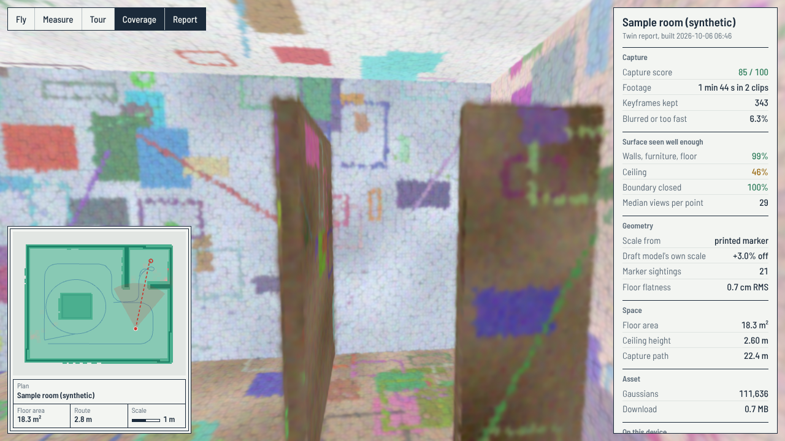

# NammaTwin

Phone video in, walkable metric 3D twin in the browser out, with a capture loop that tells you
where your footage is weak **before** you spend an hour training on it.

Built for Round 1 (3D Reconstruction & Roaming) of Namma Space, Techfest 2026-27, IIT Bombay.



## What is different about it

Most capture-to-splat pipelines are open loop: film, train, hope. This one closes the loop and
puts numbers on the result.

| Stage | What it does | Why it matters |
|---|---|---|
| **Capture linter** | Grades the video in seconds: blur, speed, texture, exposure. Picks keyframes by parallax, not by frame rate. | A bad capture is rejected in 10 seconds instead of after training. |
| **Coverage audit + recapture ticket** | On a fast draft reconstruction, finds surfaces seen from too few views or with no parallax, and open *frontiers* where the scan simply stops. Turns each into "stand here, face there, move like this". | The cheapest footage that fixes the twin, known before training. |
| **Canonical metric frame** | Floor at z = 0, walls along X/Y, 1 unit = 1 m, scale set or checked by one printed marker. The splat is *trained* in this frame. | Real eye height, real distances; the same frame serves Round 2 paths and Round 3 AR. |
| **Draft-guided bundle adjustment** | The draft poses choose which image pairs COLMAP matches. | About 9% of exhaustive matching on the sample, with loop closures and recapture clips linked. |
| **One grid, three jobs** | A 5 cm walkable grid from the trained splat gives the viewer its collision, its live floor plan, and shortest-path routing. | The Round 2 navigation map already exists. |
| **Twin report card** | Capture, coverage, geometry, fidelity, size, and the viewer's own load time and frame rate, shown beside the scene. | Every claim in the abstract has a number behind it. |

## Pipeline

```
 phone video
     │
 1.  lint ─────────────► lint_report.html, keyframes/            CPU, seconds
     │
 2.  draft poses        MapAnything: metric poses + dense points  GPU, minutes
     │
 3.  align ────────────► gravity, Manhattan axes, metres (marker) CPU, seconds
     │
 4.  audit ────────────► recapture_ticket.html ──┐                CPU, seconds
     │                                           │ shoot the items,
     │   ◄───────────── lint --append ◄──────────┘ run 1 to 4 again
     │
 5.  final poses        COLMAP, pairs chosen from the draft       CPU, minutes
     │                  then aligned onto the draft's frame
 6.  train              gsplat (MCMC, fixed Gaussian budget)      GPU, 20 to 40 min
     │
 7.  clean, compress (SOG), nav grid, report card                 CPU, seconds
     │
 web viewer             WASD + mouse, collision, plan, measure, tour
```

## Quick start (no GPU needed)

This runs every CPU stage on a synthetic room and opens the result in the viewer.

```bash
pip install -r requirements.txt
python -m nammatwin sample --out work_sample --scene viewer/public/scene   # about 40 s
cd viewer && npm install && npm run dev                                    # open the printed URL
```

Viewer controls: click the view, then `W A S D` to walk and the mouse to look; `Shift` to hurry;
click the plan to walk somewhere by the shortest route; `F` fly, `M` measure, `T` replay the
capture path, `C` coverage overlay, `R` report. On a phone, drag the left half to walk and the
right half to look.

## Your own space

Read [docs/SOP.md](docs/SOP.md) first: capture decides quality. Then, on a machine with an NVIDIA
GPU (a free Colab T4 works; see [notebooks/NammaTwin_Colab.ipynb](notebooks/NammaTwin_Colab.ipynb)):

```bash
bash scripts/setup_gpu.sh                                   # once
python -m nammatwin marker --out marker.png                 # print it, measure the black square

export MARKER_SIZE=0.150 TITLE="Our flat"                   # your measured edge, in metres
bash scripts/run_pipeline.sh walkthrough.mp4 work           # lint, draft, align, audit
#   open work/audit/recapture_ticket.html, shoot what it asks for, then:
bash scripts/run_pipeline.sh --append topup.mp4 work        # repeat until it says READY
bash scripts/run_pipeline.sh --finish work                  # final poses, training, packaging

cd viewer && npm install && npm run build                   # viewer/dist is the whole website
```

`viewer/dist` is static: host it on GitHub Pages, Netlify, Cloudflare Pages or any file server.
All URLs are relative, so it works from a sub-folder.

**If COLMAP fails** (blank walls can defeat feature matching), rerun the last step with
`FINAL_POSES=draft`: the feed-forward poses are re-expressed for the full-resolution keyframes and
gsplat refines them during training.

Each stage is also a command of its own; `python -m nammatwin --help` lists them.

## What has been verified, and what has not

Tested in this repository (run `python -m pytest tests -q`, 19 tests, about 80 s):

| Check, on the synthetic room with known ground truth | Result |
|---|---|
| Linter flags the injected whip-pan and the injected motion blur | both found, pan graded `fail` |
| Alignment recovers gravity, wall axes and metres from a tilted, rotated, rescaled model (3 random cases) | floor flat to under 2 cm, room size within 10 cm |
| Marker catches a draft that is 3.00% out of scale | measures 2.95 to 3.04% |
| Audit points into the alcove the walker never entered | yes; verdict `RECAPTURE` |
| Top-up clip the ticket asks for, appended and re-audited | walls and furniture 96.7% to 99.4% well observed; verdict `READY` |
| Frontier detection where a scan stops with no wall | found, right place and length |
| Real COLMAP on the rendered keyframes with draft-guided pairs | 337 of 343 registered, 9% of exhaustive pairs, 0.6 cm RMS from the draft |
| PLY to SOG compression keeps the frame | 7.6 MB to 0.66 MB, same bounding box in the viewer |
| Viewer (headless Chromium): loads, walks, stops at walls, routes, measures, phone layout | pass (`tests/viewer_smoke.py`) |
| `scripts/run_pipeline.sh` end to end, GPU stages replaced by stand-ins | pass (`tests/test_pipeline_script.sh`) |

**Not yet run:** the two GPU stages (MapAnything draft, gsplat training) and a real phone capture.
The machine this was written on had no GPU and could not reach the model weights. Those stages are
called exactly as their upstream READMEs describe, and the test stand-ins in `tests/stubs` mimic
their inputs and outputs, but expect to fix small things on the first real run. The thresholds in
the linter and audit are sensible defaults tuned on synthetic footage; revisit them after your
first few real captures. The sample scene is a procedurally textured box room, not a real place.

## Repository layout

```
nammatwin/        the CPU-side pipeline (lint, align, audit, nav grid, report) and the synthetic room
scripts/          setup_gpu.sh, run_pipeline.sh, final_poses_colmap.py
viewer/           the web viewer (three.js + Spark), sample scene in viewer/public/scene
tests/            unit tests, viewer smoke test, pipeline script test, GPU-stage stand-ins
tests/sample/     sample input clips and the outputs they should produce
docs/             capture SOP, technical abstract draft, submission checklist
notebooks/        Colab notebook for the GPU stages
```

## Credits and licences

This repository is MIT licensed. It builds on, and does not copy code from:

| Tool | Used for | Licence |
|---|---|---|
| [MapAnything](https://github.com/facebookresearch/map-anything) | draft metric poses and points | Apache-2.0 code; use the `facebook/map-anything-apache` weights (`--apache`), the default weights are CC-BY-NC |
| [COLMAP / pycolmap](https://github.com/colmap/colmap) | bundle-adjusted poses | BSD-3-Clause |
| [gsplat](https://github.com/nerfstudio-project/gsplat) | Gaussian-splat training | Apache-2.0 |
| [splat-transform](https://github.com/playcanvas/splat-transform) | SOG compression | MIT |
| [Spark](https://github.com/sparkjsdev/spark) and [three.js](https://threejs.org) | browser rendering | MIT |
| [OpenCV](https://opencv.org) (ArUco), NumPy, SciPy, Matplotlib | everything CPU-side | Apache-2.0 / BSD |
| [Barlow](https://github.com/jpt/barlow) typeface | viewer UI | SIL OFL 1.1 |

Credit these in the technical abstract (rule 4 of the competition).
